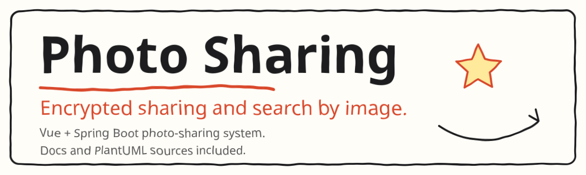

<div align="center">

<picture>
  <source media="(prefers-color-scheme: dark)" srcset="docs/assets/hero.svg">
  
</picture>

**A Vue + Spring Boot photo-sharing system, with encrypted sharing and search by image.**

[Development docs](docs/thesis/README.md) · [PlantUML sources](docs/diagrams/) · [Database setup](database/README.md)

**[Quick start](#-quick-start) · [Features](#-features) · [Docs](#-docs) · [License](#-license)**

**English** · [简体中文](README.zh-CN.md)

</div>

## ❤️ Sponsor

| Sponsor | What it is |
| :--- | :--- |
| [](https://hrouter.net/home) | **[HRouter](https://hrouter.net/home)**: model access, API key management, and usage tracking for AI coding and application development. Also operated by the maintainer. |

## 🚀 Quick start

1. Install the language runtimes and database named in the project's dependency declarations.
2. Use the dependency entry points and initialization notes below, and install dependencies for each module.
3. Search for `CHANGE_ME_BEFORE_RUNNING` and fill in your local configuration. Do not commit real passwords, tokens, or third-party service keys.
4. Start the backend, then start the frontend or import the client in a mini-program developer tool.

The commands below are listed from files that exist in the repo. **They do not mean the full project has been installed, integrated, or run.**

### Frontend / Node.js

From `front/`:

```bash
npm install
npm run dev
```

### Java / Maven

- `server/pom.xml`

Build with that module's Maven setup. In a multi-module project, build in parent/child dependency order and start the service with its original configuration. Do not use placeholder values from the sample configuration in production.

## ✨ Features

| Area | What the existing docs describe |
| :--- | :--- |
| Photo sharing | Encrypted sharing and search by image |
| User | Register, log in (JWT), browse images, browse the forum, and manage a personal account |
| Admin | App users, images, and the forum |
| Source | `front/` and `server/` |

Image browsing in the development doc covers likes, favorites, category and sort queries, and search by image. Forum browsing covers posts, comments, replies, and likes. Personal management covers stats, forum and image management, uploads, profile edits, and favorites.

## 📚 Docs

- [Development docs](docs/thesis/README.md): Markdown with figures, readable on GitHub.
- [PlantUML sources](docs/diagrams/): 8 files (`.plantuml` / `.puml` / `.wsd`).
- [Database setup](database/README.md)

## 📄 License

Existing third-party LICENSE, NOTICE, and author statements stay as they are. This project does not replace those licenses and does not claim that all of the code is under one open-source license. The license file already in the frontend tree is [front/LICENSE](front/LICENSE).

## 📈 Star history

<a href="https://www.star-history.com/#honestTai/vue-springboot-photo-sharing&Date">
  <picture>
    <source media="(prefers-color-scheme: dark)" srcset="https://api.star-history.com/svg?repos=honestTai/vue-springboot-photo-sharing&type=Date&theme=dark">
    
  </picture>
</a>

---

<div align="center">

Made by **[honestTai](https://github.com/honestTai)** · [HRouter](https://hrouter.net/home) · [More projects](https://github.com/honestTai)

</div>
